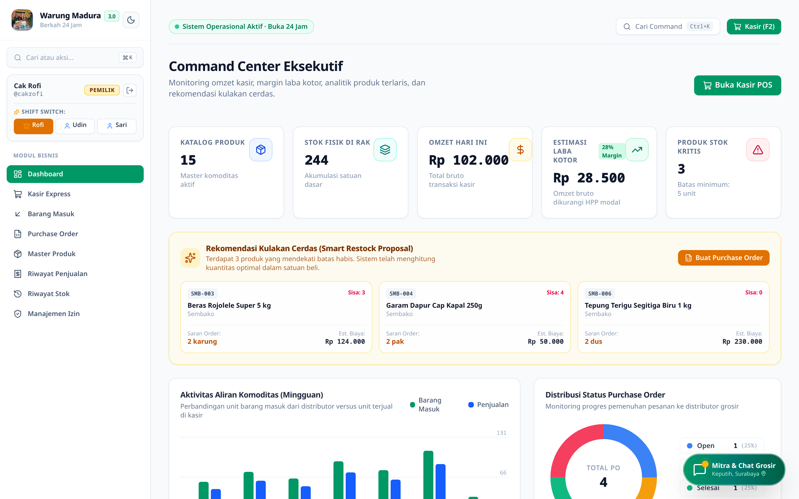
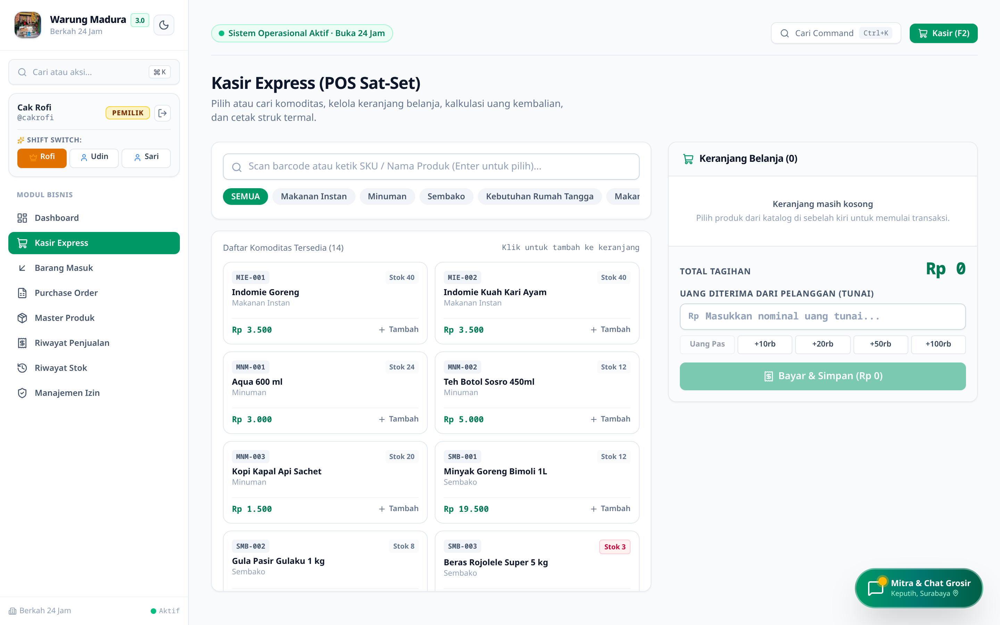

# Warung Madura Stock and POS Manager (DevSprint 3.0 Edition)

Full-stack retail inventory, multi-tier unit conversion (`Eceran`, `Pak`, `Slop`, `Dus`, `Karung`), Purchase Order (PO) lifecycle, and high-speed Point of Sale (POS) platform engineered for 24-hour FMCG retail operations. Built with strict Role-Based Access Control (RBAC) that isolates wholesale cost prices (`harga_beli`) and gross margin analytics exclusively to store owners while providing sub-second barcode/keyboard checkout for cashiers and warehouse staff.

---

## System Preview

### Executive Command Center — Gross Profit Margin, Smart Restock Proposal, and Weekly Flow


### Kasir Express (POS Sat-Set) — Barcode/SKU Instant Checkout and Thermal Receipt Engine


---

## Core Engineering Capabilities

1. **Multi-Tier Unit Conversion and Atomic Stock Deduction**
   - Supports hierarchical retail packaging units (`pcs/bungkus`, `pak/renteng`, `slop`, `dus/karton`, `karung`) with automatic base-unit normalization and atomic inventory ledger entries (`riwayat_stok`).
   - Prevents negative stock race conditions during concurrent cashier checkouts.

2. **Strict Role-Based Access Control (RBAC) and Cost Price Masking**
   - Enforces three operational roles (`Pemilik / Owner`, `Staf Gudang`, `Staf Kasir`) with instant 1-click shift switching (`Shift Switch`) and PIN verification.
   - Server-side middleware strips wholesale cost (`harga_beli`) and gross margin fields from API payloads when accessed by non-owner roles.

3. **Kasir Express POS (`Sat-Set`) and 58mm Thermal Receipt Generator**
   - Keyboard-first checkout interface with instant SKU/barcode filtering, quick cash denomination buttons (`Uang Pas`, `+10rb`, `+20rb`, `+50rb`, `+100rb`), automatic change calculation, and printable 58mm thermal receipts.
   - Includes a global Command Palette (`Ctrl+K`) for rapid navigation across modules.

4. **Smart Restock Proposal and Supplier Purchase Order (PO) Workflow**
   - Continuously monitors safety stock thresholds (`batas_minimum`), calculates optimal reorder quantities in wholesale units (`dus`/`karung`), estimates restock capital requirements, and generates tracked Purchase Orders (`Draft` -> `Open` -> `Received`).

---

## Technology Stack

- **Runtime & Backend:** Node.js, Express.js, TypeScript (compiled to ES/CommonJS in `server/dist`)
- **Frontend:** React 18, Vite, Tailwind CSS, Lucide Icons
- **Storage & State:** In-Memory / Persistent JSON & SQL-ready repository layer with deterministic seed state
- **Deployment:** Docker, Vercel, Google Cloud Run ready

---

## Quick Start

```bash
# 1. Install dependencies
npm install

# 2. Start production server
PORT=3000 node server.js
```

### Demo Accounts (1-Click Shift Switch Available on Login Screen)
- **Owner (`Cak Rofi`):** Username `cakrofi` | PIN `123456` (Full RBAC + Gross Margin + PO Approval)
- **Warehouse (`Udin`):** Username `udin` | PIN `1111` (Inbound Stock & Restock, Cost Masked)
- **Cashier (`Sari`):** Username `sari` | PIN `2222` (Kasir Express POS & Checkout)
